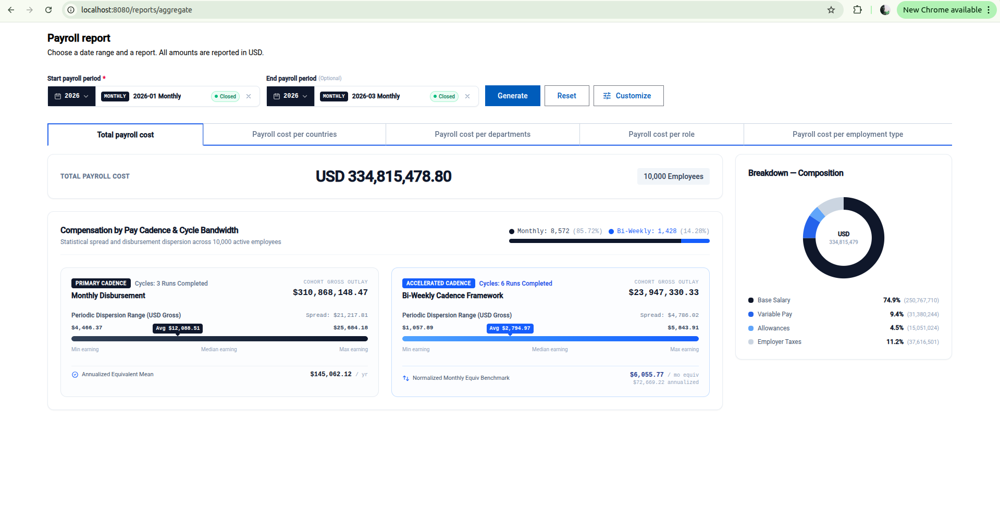

# Salary Management — Incubyte Assessment

> A web-based salary management platform for ACME's HR team — replacing
> spreadsheet-based salary tracking for 10,000 employees across multiple countries.

**Status:** 🟢 Slice 1 complete — aggregate report working end-to-end (M1–M7).

**Submitted by:** Christelle Mamekem Ngueguim
**Contact:** mnchristelle@gmail.com · [LinkedIn](https://linkedin.com/in/christelle-mamekem-ngueguim) · [GitHub](https://github.com/christaime)

---

## 📌 What Works Today

- **Seeded SQLite database** — 10,000 employees, 4 countries, 4 departments,
  5 roles, 19 payroll periods (6 monthly + 13 bi-weekly), ~68,700 payroll
  summaries, plus snapshots (aggregates + earner rankings) for closed periods.
- **Aggregate report** — select a payroll period range, optionally filter by
  Country, Department, Role, and Employment Type, and toggle between Total,
  Country, Department, Role, and Employment Type aggregations.
- **Single deployable JAR** — the Angular SPA is bundled into the Spring Boot
  JAR. One process serves both the API (`/api/v1/**`) and the SPA (deep links
  like `/reports/aggregate` resolve correctly via an `index.html` fallback).
- **CI on every push and PR** — backend tests (JUnit 5), frontend unit tests
  (Jasmine / Karma), production build, and Cypress end-to-end tests.

---

## 🎯 Scope of Slice 1

The Slice 1 deliverable is a working aggregate report over seeded data. The HR
manager opens the app, picks a payroll period range, and sees a table of
payroll totals. They can customize the view by opening the filter drawer and
can switch the report dimension using the kind toggle (Total, Country,
Department, Role, Employment Type).

**Not in Slice 1** — these are planned for later milestones and do not
currently exist in the app:

- Ranking and comparison reports (M8)
- Employee CRUD and assignment editing (M9)
- Payroll recording and validation (M10)
- Payroll period create / edit / close (M11)
- Authentication and authorization
- Deployment (M12)

---

## 🏗️ Stack

| Layer | Technology |
| :--- | :--- |
| Backend | Spring Boot 3.3, Java 17, Gradle |
| Persistence | SQLite, Flyway, Spring Data JPA, MapStruct |
| Frontend | Angular 19 (standalone components, signals, OnPush) |
| UI | Angular Material + Tailwind CSS |
| Testing | JUnit 5 / Mockito (backend), Jasmine / Karma (frontend), Cypress (E2E) |
| CI | GitHub Actions (`.github/workflows/ci.yml`) |

---

## 🚀 Running Locally

### Single JAR (production-like)

```bash
cd backend
./gradlew bootJar
java -jar build/libs/salary-management-0.0.1-SNAPSHOT.jar
```

Then open <http://localhost:8080/reports/aggregate>.

The `bootJar` task builds the Angular frontend, copies the output into the
backend's `src/main/resources/public/`, and bundles everything into one JAR.

### Dev mode (hot reload)

Two terminals:

```bash
# Terminal 1 — backend API on :8080
cd backend
./gradlew bootRun
```

```bash
# Terminal 2 — Angular dev server on :4200
cd frontend
npm install
npm start
```

Then open <http://localhost:4200>. The dev server proxies `/api/**` to
`http://localhost:8080` via `frontend/proxy.conf.json`.

### Database

The SQLite file lives at `backend/data/salary-management.db` by default. Flyway
runs migrations and seed scripts on startup. To point at a different database
or seed directory, set the `DB_URL` / `DB_SEED_DIR_PATH` environment variables
(see `backend/src/main/resources/application.yml`).

---

## 📁 Project Structure

```
salary-management-incubyte/
├── .github/
│   └── workflows/
│       └── ci.yml                  # backend + frontend tests, Cypress E2E
├── backend/                        # Spring Boot application
│   ├── src/main/java/com/salary/management/
│   │   ├── domain/                 # entities, value objects, ports
│   │   ├── application/            # services, use cases
│   │   ├── infrastructure/
│   │   │   ├── api/                # controllers, DTOs, exception handling
│   │   │   ├── database/           # JPA entities, adapters, migrations
│   │   │   └── reporting/          # snapshot builder, currency converter
│   │   └── ...
│   ├── src/main/resources/
│   │   ├── db/migration/           # Flyway schema migrations
│   │   ├── db/seed/                # seeded reference and payroll data
│   │   ├── public/                 # built Angular SPA (generated)
│   │   └── application.yml
│   └── build.gradle.kts
├── frontend/                       # Angular application
│   ├── src/app/
│   │   ├── core/                   # interceptors, models, global services
│   │   ├── shared/                 # shared components, pipes
│   │   └── features/reports/       # aggregate report feature
│   ├── cypress/e2e/                # end-to-end tests
│   └── proxy.conf.json
├── docs/
│   ├── architecture.md
│   ├── adr/
│   ├── diagrams/
│   └── screenshots/
├── README.md
├── REQUIREMENTS.md
└── AI_WORKFLOW.md
```

---

## 🔌 API

The application exposes the aggregate report endpoint and interactive documentation.

### `POST /api/v1/reports/aggregate`

Generate an aggregate payroll report over a date range, grouped by one or more
dimensions.

**Request**

```json
{
  "dateRange": { "startDate": "2026-01-01", "endDate": "2026-03-31" },
  "groupKeys": ["COUNTRY", "DEPARTMENT"],
  "anyCountryIds": null,
  "anyDepartmentIds": null,
  "anyRoleIds": null,
  "anyEmploymentTypes": ["FULL_TIME"],
  "includeBreakdown": false,
  "includeStatistics": true
}
```

**Response** (200)

```json
{
  "kind": "AGGREGATE",
  "dateRange": { "startDate": "2026-01-01", "endDate": "2026-03-31" },
  "groupKeys": ["COUNTRY", "DEPARTMENT"],
  "referenceCurrency": "USD",
  "lines": [
    {
      "amount": { "amount": 1250000.00, "currency": "USD" },
      "employeeCount": 42,
      "country": "FR",
      "department": "Engineering",
      "statistics": {
        "min": { "amount": 35000.00, "currency": "USD" },
        "max": { "amount": 120000.00, "currency": "USD" },
        "average": { "amount": 29761.90, "currency": "USD" }
      }
    }
  ],
  "warnings": []
}
```

**Errors**

- `400 VALIDATION_FAILED` — request validation (reversed date range, future
  end date, duplicate group keys, statistics with more than one key, or
  unsupported `ORIGIN_COUNTRY` key).
- `400 REPORT_BLOCKED` — data prerequisite missing (e.g., missing FX rate,
  unvalidated payroll summaries, closed period, or missing reference currency).
- `404 NOT_FOUND`, `500 INTERNAL_ERROR`

**Documentation & Health**

- **Swagger UI**: <http://localhost:8080/swagger-ui/index.html> (interactive API docs)
- **Actuator Health**: `/actuator/health`
- **Actuator Metrics**: `/actuator/metrics`

---

## 🧪 Testing

```bash
# Backend unit + integration tests
cd backend && ./gradlew test

# Frontend unit tests (Jasmine / Karma, headless)
cd frontend && npm test -- --watch=false --browsers=ChromeHeadless

# Frontend end-to-end tests (Cypress)
cd frontend && npm run e2e
```

CI runs all three suites on every push to `main` and `develop`, and on every
pull request. Cypress artifacts (screenshots, videos) are uploaded on failure
for triage.

---

## 📸 Screenshots



---

## 🗺️ Milestones

| Milestone | Focus | Status |
| :--- | :--- | :--- |
| M1 | Domain models, ports, enums | ✅ |
| M2 | Persistence (JPA, Flyway, adapters) | ✅ |
| M3 | Seed data (10,000 employees, 19 periods) | ✅ |
| M4 | Snapshot builder | ✅ |
| M5 | Aggregate report backend | ✅ |
| M6 | Aggregate report frontend | ✅ |
| M7 | Single JAR, CI, documentation | ✅ |
| M8 | Ranking and comparison reports | ⏳ |
| M9 | Employee CRUD | ⏳ |
| M10 | Payroll recording | ⏳ |
| M11 | Payroll period management | ⏳ |
| M12 | Deployment, demo, final docs | ⏳ |

---

## ⚠️ Known Limitations

- **`ORIGIN_COUNTRY` group key is unsupported.** The backend rejects it with
  `VALIDATION_FAILED` / `UNSUPPORTED_GROUP_KEY`. The frontend does not offer
  it as an option.
- **No authentication.** Every endpoint is publicly accessible.
- **No deployment.** The app runs locally; production deployment and a demo
  video are M12 deliverables.

---

## 📬 Submission

Submitted in response to the Incubyte Software Craftsperson (Java/Angular II)
take-home assessment, October 2026.

For questions or clarifications, feel free to reach out:
**mnchristelle@gmail.com**
