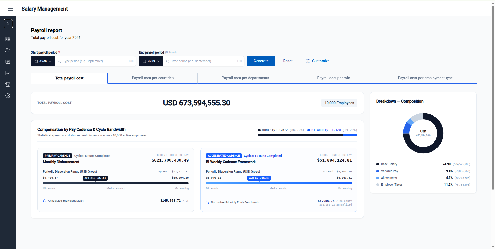
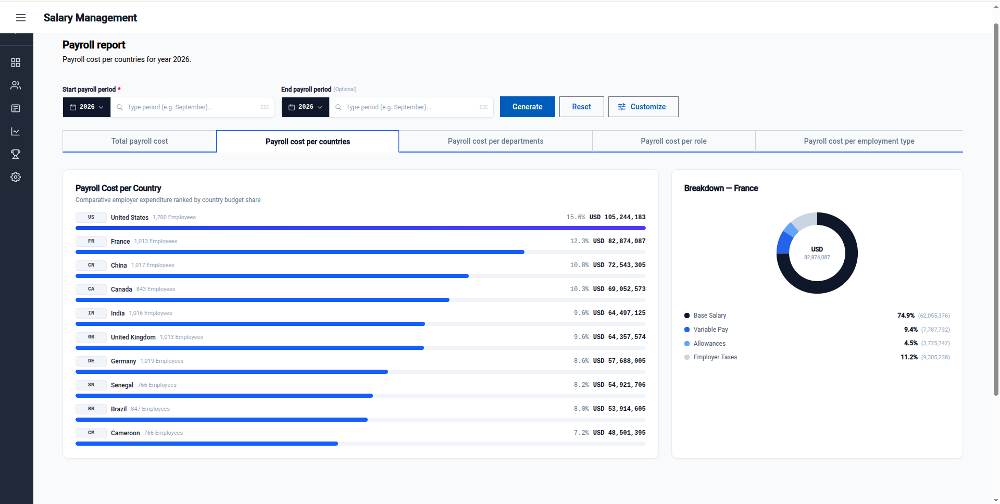
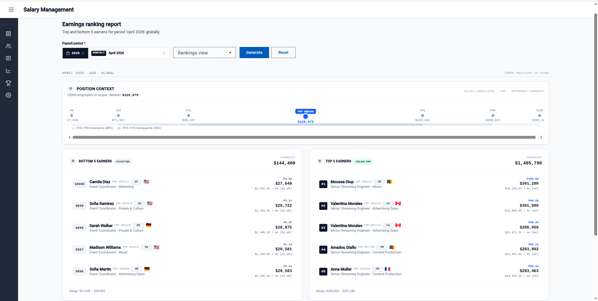
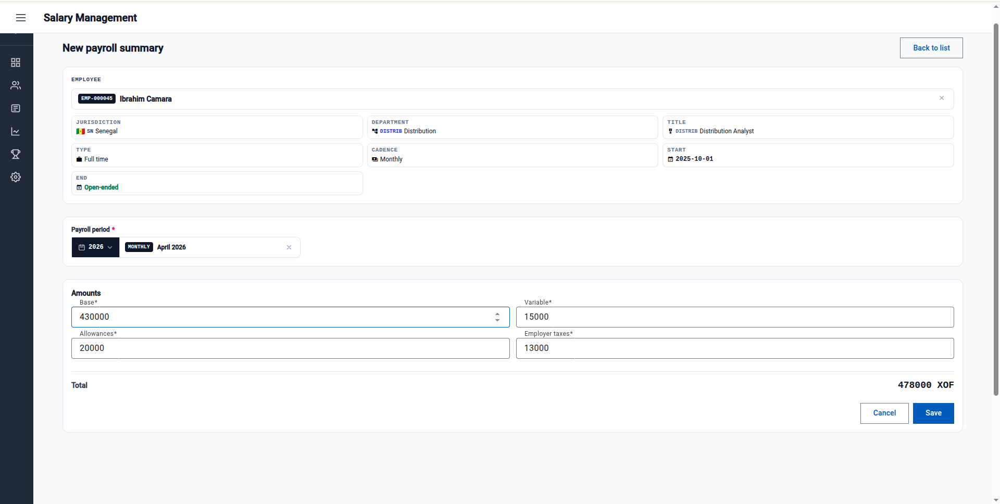

# Salary Management — Incubyte Assessment

> A web-based salary management application for ACME's HR team. It manages
> payroll records for 10,000 employees across multiple countries and answers
> questions about how the organization pays people.

**Submitted by:** Christelle Mamekem Ngueguim
**Contact:** mnchristelle@gmail.com · [LinkedIn](https://linkedin.com/in/christelle-mamekem-ngueguim) · [GitHub](https://github.com/christaime)

**Status:** Runs locally as a single JAR. Not deployed; no video demo recorded.

---

## Quick Start

### Prerequisites

- Java 17
- Node.js 20+ and npm
- No external database — SQLite is embedded

### Backend (dev)

```bash
cd backend
./gradlew bootRun
```

The API is served at <http://localhost:8080>. Swagger UI is at
<http://localhost:8080/swagger-ui.html>.

### Frontend (dev)

```bash
cd frontend
npm install
npm start
```

The Angular dev server runs at <http://localhost:4200>. The backend's
`CorsConfig` allows requests from `http://localhost:4200`, so the SPA calls
the API directly at `http://localhost:8080` in development. There is no
proxy config file — CORS is the mechanism.

### Production-like (single JAR)

```bash
cd backend
./gradlew bootJar
java -jar build/libs/salary-management-0.0.1-SNAPSHOT.jar
```

The `bootJar` task runs the frontend build (`npmInstall` → `npmBuild` →
`copyFrontendToPublic`), copies the output into the backend's
`src/main/resources/public/`, and bundles everything into one JAR that serves
both the API and the SPA. Deep links such as `/reports/aggregate` resolve
through an `index.html` fallback.

### Database and seed

The SQLite file lives at `backend/data/salary-management.db` by default.
Flyway applies schema migrations and seed scripts on startup. The seed lives
in `backend/src/main/resources/db/seed/`, separate from migrations.

To disable the seed (e.g. to run against an already-seeded database), set:

```bash
DB_SEED_DIR_PATH=classpath:db/seed-disabled
```

`DB_URL` overrides the database location. See
`backend/src/main/resources/application.yml` for all options.

---

## Project Structure

```
salary-management-incubyte/
├── backend/
│   ├── src/main/java/com/salary/management/
│   │   ├── domain/              # models, value objects, ports (plain Java)
│   │   ├── application/         # DTOs, mappers, services, exception
│   │   ├── infrastructure/
│   │   │   ├── api/             # controllers, advice, config
│   │   │   ├── database/        # SQLite directory initializer
│   │   │   └── persistence/     # entities, mappers, adapters, specs, JDBC
│   │   └── common/              # pagination, validation, exceptions
│   ├── src/main/resources/
│   │   ├── db/migration/        # Flyway migrations
│   │   ├── db/seed/             # seed scripts
│   │   └── public/              # built SPA (generated by bootJar)
│   └── build.gradle
├── frontend/
│   ├── src/app/
│   │   ├── core/                # interceptors, models, shared UI
│   │   ├── features/            # employee, payroll, reports
│   │   └── layout/              # header, sidebar
│   └── cypress/e2e/             # end-to-end tests
├── docs/
│   ├── architecture.md
│   ├── clean-architecture.md
│   ├── use-cases.md
│   ├── planning.md
│   ├── adr/
│   ├── ai/
│   └── screenshots/
├── .github/workflows/ci.yml
├── REQUIREMENTS.md
├── AI_WORKFLOW.md
└── README.md
```

---

## What's Built

Every claim below can be verified by running the app.

- **Aggregate report** — `POST /api/v1/reports/aggregate`, plus a frontend
  page at `/reports/aggregate`. Select a date range, choose one or more group
  keys (`COUNTRY`, `DEPARTMENT`, `ROLE`, `EMPLOYMENT_TYPE`, `CURRENCY`),
  apply selection filters, and toggle breakdown and statistics. **Open
  periods are rebuilt on every read; closed periods are read from their
  frozen snapshot.** Rebuilds are all-or-nothing: if any period in the range
  blocks, nothing is written and the report is not produced.
- **Ranking report** — `POST /api/v1/reports/rankings`, plus a frontend page.
  Returns the top 5 and bottom 5 by **monthly rate** (not raw amount), a
  7-point percentile distribution (min, p10, p25, p50, p75, p90, max), and
  each earner's interpolated percentile in basis points. **Open periods are
  rebuilt on every read; closed periods read the frozen ranking and
  percentile snapshots.**
- **Employee management** — create, update, and delete employees; assign
  employees to placements via an inline editor on the employee edit form;
  search by matricule, name, email, or current placement; list employees. The
  update endpoint can atomically close the in-effect assignment and create a
  new one in the same request.
- **Payroll recording** — create, update, and delete `DRAFT` payroll
  summaries; validate single or bulk summaries; search payroll by date range
  and dimensions. `nonExistent=true` returns employees with an in-effect
  assignment who have **no** payroll summary for the period — the query
  behind the "missing payroll summary" warning. Bulk validation is
  **not atomic**: successful rows commit, per-row failures are reported.
- **Seed data** — 10,000 employees with deterministic IDs, 10 countries,
  10 departments, 12 roles, 8 currency rates, and 19 payroll periods (6
  monthly + 13 bi-weekly from 2026-01-01, mixed closed and open). Payroll
  summaries are seeded with ~70,000 rows: `VALIDATED` for closed periods,
  `DRAFT` for open ones. Aggregates and rankings are seeded for closed
  periods.
- **Snapshot builder** — `PayrollPeriodSnapshotRepositoryAdapter` builds and
  persists the snapshots from `VALIDATED` payroll summaries.
  `buildAndSaveAggregates(period)` rebuilds the aggregate snapshot;
  `buildAndSaveRankings(period)` rebuilds the ranking and percentile
  snapshots. Each returns warnings and blockers, and each replaces the
  period's DRAFT rows in the same call. Only open periods are rebuilt; the
  policy lives in the calling service.
- **Single JAR packaging** — the backend serves the compiled Angular SPA.
- **CI** — GitHub Actions runs backend tests, frontend unit tests, the
  production build, and Cypress end-to-end tests on every push and pull
  request.
- **API documentation** — springdoc-openapi exposes Swagger UI.

---

## Architecture

Clean architecture, applied uniformly across the codebase.

```
backend/src/main/java/com/salary/management/
├── domain/           # models, values, repository ports (plain Java)
├── application/      # DTOs, mappers, services, exception
├── infrastructure/   # api, persistence, database
└── common/           # pagination, validation, exceptions
```

Key points:

- **Domain is plain Java.** No Spring, no JPA, no HTTP annotations.
- **Repository ports** are defined in the domain; implementations live in
  infrastructure.
- **Domain objects are immutable** and built via hand-written static inner
  `Builder` classes that validate on `build()`.
- **MapStruct** maps persistence entities to domain objects.
- **No JPA relations except one documented case.** `PayrollSummaryEntity`
  uses two `@ManyToOne` (employee, payrollPeriod) so the payroll list can
  sort and filter without a per-row join. Every other foreign reference is a
  UUID column loaded explicitly by the adapter.
- **`LocalDateStringConverter`** is an `@Converter(autoApply = true)` that
  stores `LocalDate` as ISO `YYYY-MM-DD` text, so SQLite can compare dates
  lexically.
- **Snapshot-based reporting.** Aggregates, rankings, and percentiles are
  read from dedicated snapshot tables. **Open periods are rebuilt on every
  report; closed periods are read from their frozen snapshot.**

See `docs/architecture.md` for the full design, `docs/clean-architecture.md`
for how the layering is enforced, `docs/adr/` for the reasoning behind
individual decisions, and `docs/use-cases.md` for user flows.

---

## Planning

Work was planned and tracked as GitHub milestones, from domain modelling
through to a single deployable JAR. Each milestone contains its own issues and
reflects the state of the code today — including what was completed, what was
deliberately excluded, and what remains out of scope.

**Milestones:** <https://github.com/christaime/salary-management-incubyte/milestones>

| Milestone | Focus | State |
| :--- | :--- | :--- |
| M1 | Domain models, repository ports, enums, value objects, and their tests | 14/14 ✅ |
| M2 | JPA entities, Flyway migration, mappers, adapters, integration tests | 8/8 ✅ |
| M3 | Deterministic seed: 10,000 employees, mixed-frequency periods over ~6 months | 5/5 ✅ |
| M4 | Build snapshots from live payroll summaries; warnings and blockers | 4/4 ✅ |
| M5 | Aggregate report — DTOs, service, controller, error handling | 7/7 ✅ |
| M6 | Angular report page — date range, group keys, results table | 5/5 ✅ |
| M7 | Single JAR serves frontend and API; CI workflow; README update | 3/3 ✅ |
| M8 | Ranking and comparison reports | 2/4 ⚠️ Ranking done; comparison deliberately excluded |
| M9 | Employee and assignment CRUD | 5/6 ⚠️ Employee detail page deliberately excluded |
| M10 | Payroll recording, validation, payroll list | 6/6 ✅ |
| M11 | Payroll period list, create, close flow | 0/4 ❌ Not built — periods are seeded |
| M12 | Video demo, ADRs 006–010, documentation updates, deployment | 0/5 ❌ Not built |

The open issues in M8, M9, M11, and M12 are the concrete record of what was
left out of scope, and why. See **Known Limitations** below for the
user-facing consequences, and `docs/planning.md` for the reasoning behind
each exclusion.

---

## Key Design Decisions

- **Payroll is recorded, not computed.** No tax rules, gross-to-net, or
  payslips.
- **Snapshot reporting, driven by the period's `closed` flag.** Open periods
  are rebuilt on every read; closed periods are frozen at close. Reports on
  closed periods reflect what was paid, not what would be recomputed today.
- **Rankings normalize by monthly rate.** Bi-weekly and monthly earners are
  compared on the same scale; raw amount comparison would bias toward
  monthly earners.
- **`inEffect` on assignments is HR-declared**, not derived from dates.
- **No JPA relations** except the two `@ManyToOne` on `PayrollSummaryEntity`.
  Every other foreign reference is a UUID column.
- **`LocalDateStringConverter`** for SQLite date storage.
- **`currency_rates` is reshaped** with a `reference_amount` column. A
  single-reference-currency invariant is enforced by database triggers, and
  self-pairs are disallowed. Conversion formula:
  `amount_in_reference = amount_in_foreign × reference_amount / rate`.
  Today every seeded rate has `reference_amount = 1`, so the formula reduces
  to `amount / rate` for non-USD currencies; USD is identity. See
  `docs/adr/001-use-sqlite.md` for the associated constraints (no historical
  rates, single reference currency).

Reasoning for each of these lives in `docs/adr/`.

---

## API

Full documentation at `/swagger-ui.html` when running locally. Base path
`/api/v1`. All list endpoints return a `DataPage<T>` envelope and accept
`page` (0-indexed, default `0`), `size` (default `20`, max `100`),
`sortBy`, and `sortDirection`.

### Reference data

| Method | Path | Notes |
| :--- | :--- | :--- |
| `GET` | `/countries` | Filters: `keyword`, `currencyCode`. Sort: `name`, `isoCode`, `currencyCode`. |
| `GET` | `/countries/{id}` | Returns the country and its currency. |
| `GET` | `/departments` | Filters: `keyword`, `code`. Sort: `name`, `code`. |
| `GET` | `/roles` | Filters: `keyword`, `code`. Sort: `name`, `code`. |
| `GET` | `/payroll-periods` | Filters: `keyword`, `startDate`, `endDate`, `frequency`, `isClosed`. Sort: `startDate` (default `DESC`), `endDate`, `name`. **No create / edit / close endpoints** — periods are seeded only. |

### Employees

`POST /employees` requires an initial assignment. `PUT /employees/{id}` is not
a simple update — it can atomically close the in-effect assignment and create
a new one in the same request, or update the existing assignment in place.

| Method | Path | Notes |
| :--- | :--- | :--- |
| `GET` | `/employees` | Filters: `keyword`, `matricule`, `anyOriginCountryIds`, `anyAssignmentCountryIds`, `anyDepartmentIds`, `anyRoleIds`, `employmentTypes`. |
| `GET` | `/employees/{id}` | Employee + in-effect assignment. |
| `POST` | `/employees` | Create employee + initial in-effect assignment, atomically. |
| `PUT` | `/employees/{id}` | Update identity; optionally close the in-effect assignment (`toClose`) and/or create a new one (`assignmentInEffect` with `id = null`) in the same atomic request. Structural changes to an assignment are rejected once payroll exists — only `endDate` and `inEffect` remain mutable. |
| `DELETE` | `/employees/{id}` | Rejected with `DATA_CONFLICT` if the employee has any payroll summary in any status. |

### Payroll summaries

| Method | Path | Notes |
| :--- | :--- | :--- |
| `GET` | `/payroll-summaries` | **`rangeStart` and `rangeEnd` are required.** Additional filters: `employeeId`, `employeeMatricule`, `anyCountryIds`, `anyDepartmentIds`, `anyRoleIds`, `anyEmploymentTypes`, `status`, `payrollFrequency`. **`nonExistent=true`** inverts the query: it returns employees with an in-effect assignment covering the period who have **no** payroll summary — the query behind the "missing payroll summary" warning on the aggregate report. |
| `GET` | `/payroll-summaries/{id}` | Detail view. |
| `POST` | `/payroll-summaries` | Create a `DRAFT`. Rejected on closed periods. |
| `PUT` | `/payroll-summaries/{id}` | Update a `DRAFT`. Rejected on `VALIDATED`. |
| `DELETE` | `/payroll-summaries/{id}` | Delete a `DRAFT`. Rejected on `VALIDATED`. |
| `POST` | `/payroll-summaries/{id}/validate` | `DRAFT` → `VALIDATED`. Runs in its own transaction. |
| `POST` | `/payroll-summaries/validate-all` | Bulk validate. **Not atomic.** Uses keyset pagination; reports per-row failures (`SUMMARY_NOT_DRAFT`, `PERIOD_CLOSED`, `ASSIGNMENT_NOT_IN_EFFECT`, `ASSIGNMENT_DOES_NOT_COVER_PERIOD`). |

### Reports

| Method | Path | Body / notes |
| :--- | :--- | :--- |
| `POST` | `/reports/aggregate` | Aggregate report over a date range. **Only MONTHLY periods are resolved** — bi-weekly summaries contribute to their containing month's totals (see `docs/architecture.md`). Statistics are computed **per frequency** (MONTHLY and BI_WEEKLY side-by-side). |
| `POST` | `/reports/rankings` | Earner ranking for a period and dimension. Returns top 5, bottom 5, the 7-point percentile distribution, and each earner's interpolated percentile in basis points. |

There is no `/reports/comparison` endpoint. See **Known Limitations**.

### Error envelope

Every failing endpoint returns the same shape:

```json
{
  "code": "VALIDATION_FAILED",
  "message": "One or more fields are invalid",
  "errors": [
    {
      "code": "NotBlank",
      "message": "must not be blank",
      "severity": "ERROR",
      "details": { "field": "matricule", "attributes": { "max": 100 } }
    }
  ],
  "timestamp": "2026-10-31T14:30:00Z"
}
```

Top-level `code` is one of:

| HTTP | `code` | Cause |
| :--- | :--- | :--- |
| 400 | `VALIDATION_FAILED` | Domain validation failed |
| 400 | `REPORT_BLOCKED` | Snapshot build returned a blocker |
| 400 | `INVALID_REQUEST` | Bean Validation on the request body, or a malformed body |
| 404 | `NOT_FOUND` | Resource doesn't exist |
| 409 | `DATA_CONFLICT` | Unique / foreign-key / check constraint violation, or a service-level state conflict (`PERIOD_CLOSED`, `SUMMARY_NOT_DRAFT`, `ASSIGNMENT_NOT_IN_EFFECT`, `ASSIGNMENT_DOES_NOT_COVER_PERIOD`, `SUMMARY_ALREADY_EXISTS`, `ASSIGNMENT_NOT_FOR_EMPLOYEE`) |
| 500 | `INTERNAL_ERROR` | Unhandled |

`severity` on each `ApiError` is `ERROR` or `WARNING`. `REPORT_BLOCKED`
responses use both: blockers are `ERROR`, warnings are `WARNING`, and both
prevent the report from being produced.

---

## Assumptions

Before building, I sent two clarifying questions to the Incubyte team (a
sample of the current Excel file, and what specifically makes the current
process "tedious"). I did not receive a response before starting, so the
following assumptions were made and documented in the design artifacts:

- **The current process is a data-integrity and querying problem, not a scale
  problem.** 10,000 rows in a spreadsheet is unwieldy for filtering and
  joining, but not for storage. This is why the design prioritizes
  structured queries and a consistent schema over raw performance.
- **"Answer questions about how the org pays people" means aggregate
  reporting, not individual analysis.** The aggregate and ranking reports
  are the primary capability. Employee detail is secondary.
- **Payroll is recorded, not computed.** The problem statement does not
  mention tax rules, gross-to-net, or payslips. These are stated as out of
  scope.
- **Multi-country means multi-currency.** Currencies are converted to a
  reference currency for reporting; the original amounts are preserved on
  each summary.
- **A single HR manager is the user.** No authentication is built, per the
  assessment's framing.
- **The reporting surface is monthly-first.** The aggregate report resolves
  only MONTHLY periods in the range; bi-weekly summaries roll into their
  containing month. This matches the seed's monthly-window aggregate model.

Each assumption is isolated and reversible: the currency conversion is
encapsulated, the report shape is a request/response contract, and the
record-not-compute decision is documented in ADR 002.

---

## AI Workflow

AI tools were used throughout as a collaborator, not as an autopilot. The
full record is in `AI_WORKFLOW.md` and `docs/ai/`.

- **What was AI-assisted:** boilerplate (entity scaffolds, DTO mappers),
  test case generation from specification, exploration of design
  alternatives before committing.
- **What was reviewed line-by-line:** every domain invariant, every adapter
  specification, every migration script. These are the parts that would
  silently corrupt data, so they are the parts that got human eyes.
- **What was rejected:** AI-suggested `@ManyToOne` relations between
  entities (kept UUID columns instead, except the one documented case),
  eager fetching (would break the criteria pattern), and any mapping code
  that could not be verified against `docs/architecture.md`.

---

## Artifacts

- `REQUIREMENTS.md` — scope, features, and what was deliberately excluded.
- `docs/planning.md` — how the work was planned, and why features were left
  out.
- `AI_WORKFLOW.md` — how AI tools were used, and what was reviewed manually.
- `docs/architecture.md` — system design, data model, snapshot design,
  report model, diagrams.
- `docs/clean-architecture.md` — layering rules, port/adapter pattern,
  immutability, builders, validation strategy.
- `docs/use-cases.md` — user flows for employee management, assignment
  management, payroll recording, period management, and reporting.
- `docs/adr/` — architecture decisions.
- `docs/ai/` — prompts and context used during the build, per milestone.
- **GitHub milestones** — issue-level record of what was tracked and
  shipped: <https://github.com/christaime/salary-management-incubyte/milestones>

---

## Testing

```bash
# Backend — JUnit 5 + Mockito
cd backend && ./gradlew test

# Frontend unit tests — Jasmine / Karma (headless)
cd frontend && npm test -- --watch=false --browsers=ChromeHeadless

# Frontend end-to-end tests — Cypress
cd frontend && npm run e2e
```

Cypress covers the aggregate report, the earnings-ranking report, employee
management, and payroll summary flows. CI runs all three suites plus the
production build on every push and pull request
(`.github/workflows/ci.yml`); Cypress artifacts (screenshots, videos) are
uploaded on failure.

Test coverage is concentrated where it matters most: the adapter layer and
the domain. Domain tests run in milliseconds with no Spring context. Adapter
integration tests run against a real SQLite database and exercise the
specifications, sorting, and mapping logic. See `docs/clean-architecture.md`
§10 for the strategy.

---

## Screenshots

### Aggregate report — Total



Total payroll cost and statistical spread over a date range. The main card
separates cost by pay cadence (Monthly vs. Bi-weekly), showing min/median/max
spread and annualized equivalents. The donut chart on the right breaks down
the total cost by component (Base, Variable, Allowances, Employer Taxes). Tabs
allow switching the primary group dimension.

### Aggregate report — Cost by country



The same aggregate report, grouped by `COUNTRY`. The horizontal bar chart
ranks the organization's payroll expenditure by country budget share,
displaying the headcount and total cost (in the reference currency) for each.
Selecting a country's bar reveals the right-hand donut chart, which shows the
component breakdown (Base, Variable, Allowances, Employer Taxes) for that
specific country's total.

### Ranking report



Top and bottom earners for a specific period and dimension. The
**Position Context** bar visually anchors the selected group within the broader
company pay distribution (min, p10, median, p90, max). The Top 5 and Bottom 5
cards list each earner with their percentile badge, monthly rate, and
annualized amount, normalizing bi-weekly and monthly cadences to a comparable
scale.

### Payroll summary editor



Recording or editing a `DRAFT` payroll summary. The top section displays the
employee and their resolved in-effect assignment (jurisdiction, department,
role, cadence) as read-only context, ensuring the payment is tied to the
correct placement. The bottom section captures the amount components (base,
variable, allowances, employer taxes) and computes the total.

---

## Known Limitations

These are real limitations, not hedges.

1. **Payroll period management is not built.** Periods are seeded only. The
   HR manager cannot create or close periods through the UI or the API.
2. **The comparison report is not built.** Only aggregate and ranking
   reports exist. The `ReportKind.COMPARISON` enum value is a placeholder
   for the planned report; no code produces it.
3. **The employee detail page is not built.** The employee list and edit
   form cover the essential flows.
4. **No authentication or authorization.** The assessment scoped the system
   to a single trusted user.
5. **`ORIGIN_COUNTRY` group key is unsupported.** `PayrollPeriodAggregate`
   does not carry the employee's origin country. The endpoint rejects it
   with `VALIDATION_FAILED` / `UNSUPPORTED_GROUP_KEY`.
6. **Statistics require at most one group key.** Requesting statistics with
   more than one dimension returns `VALIDATION_FAILED`.
7. **Groups with fewer than 10 employees have no percentile distribution.**
   The seed only ranks groups of 10 or more; smaller groups surface as a
   null `positionContext` rather than an error.
8. **Filters in the aggregate report form use static lists.** The country /
   department / role list endpoints are paginated, but the report form uses
   the seeded reference lists.
9. **`NUMERIC(38, 2)` for money in SQLite.** SQLite stores `NUMERIC` as
   `REAL` (IEEE-754) with about 15 significant digits. This is safe for
   payroll amounts; a system requiring exact arithmetic at extreme
   magnitudes would use `TEXT` storage.
10. **Excel import is out of scope.** The seed replaces it.
11. **Payroll execution is out of scope.** No tax computation, gross-to-net,
    or payslips.
12. **No historical currency rates.** Conversion uses the current
    `currency_rates` row, not the rate at payroll time. Changing the
    reference currency would require a full-DB re-conversion of every
    aggregate, ranking, and percentile row.
13. **No audit trail, backup, or disaster recovery.**
14. **Not deployed.** The app runs locally as a JAR. A video demo has not
    been recorded.

---

## Submission

Submitted in response to the Incubyte Software Craftsperson (Java/Angular II)
take-home assessment.

For questions: **mnchristelle@gmail.com**
