# Architecture

> Status: reflects the built system. Sections marked **Built** describe code that
> exists. Sections marked **Planned** describe what a feature would look like if
> it were built.

## Overview

Salary Management is a web application with a Java backend and an Angular
frontend, packaged as a single deployable JAR. The backend exposes a REST API
and serves the compiled frontend. Data is stored in SQLite.

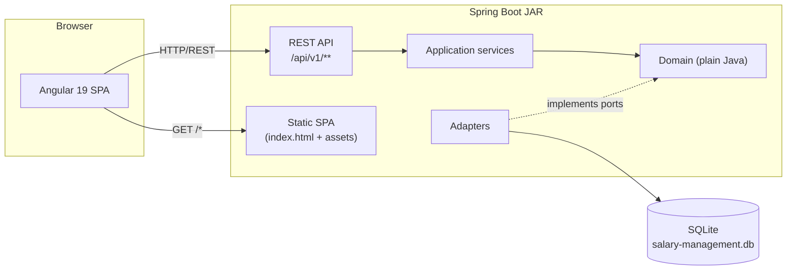

The single JAR serves both the compiled SPA and the API. Deep links such as
`/reports/aggregate` are handled by an `index.html` fallback, so the SPA can
route client-side.

## System Context

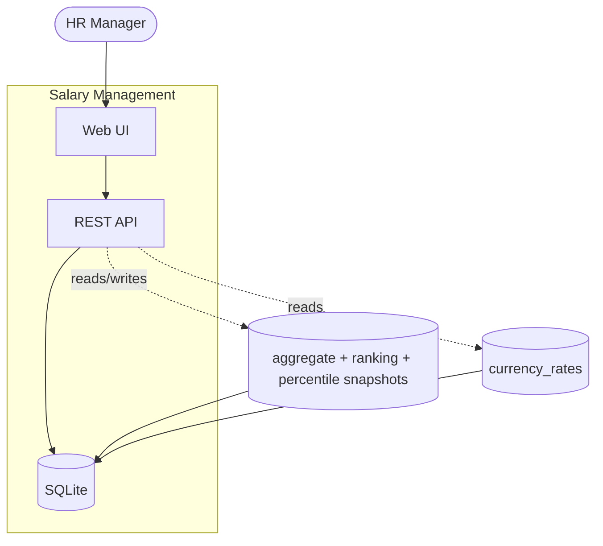

The system has one user: the HR Manager. They use it to:

- Record employees and their assignments
- Record payroll summaries
- Validate payroll (and — in a future milestone — close payroll periods)
- Generate reports about how the organization pays people

There is no authentication. The application assumes a single trusted user and
that infrastructure restricts access.

## Technology Stack

| Concern | Choice | Rationale |
| :--- | :--- | :--- |
| Backend language | Java 17 | Matches role requirement |
| Backend framework | Spring Boot 3.3 | Mature ecosystem; matches role requirement |
| Build tool | Gradle | Matches role requirement |
| Database | SQLite | Zero-config for reviewers; sufficient for a read-heavy single-user system |
| Schema management | Flyway | Migration-driven schema; `ddl-auto: validate` ensures Hibernate never alters the schema |
| Frontend | Angular 19 | Standalone components, signals, OnPush |
| UI library | Angular Material + Tailwind | Material for complex widgets; Tailwind for layout and custom components |
| Testing (backend) | JUnit 5 + Mockito | Standard for Spring Boot |
| Testing (frontend) | Jasmine / Karma | Standard for Angular |
| CI | GitHub Actions | Backend + frontend tests, production build, Cypress E2E |

### Why SQLite

SQLite is zero-config: a reviewer can clone the repository and run it without
installing a database server. The workload is read-heavy with a single user,
so SQLite's single-writer limitation is not a bottleneck.

In production, the database would be PostgreSQL — for concurrent writes,
enforced constraints, and richer analytical functions. The swap is a
datasource change, not a code change.

### Why a single deployable JAR

The frontend is compiled and bundled into the backend's static resources, so
the application ships as one artifact. This simplifies deployment and matches
the "fully functional deployed software" requirement. The `bootJar` task
drives the frontend build (`npmInstall` → `npmBuild` → `copyFrontendToPublic`)
before packaging, so a single `./gradlew bootJar` produces the whole
application.

## Backend Layers

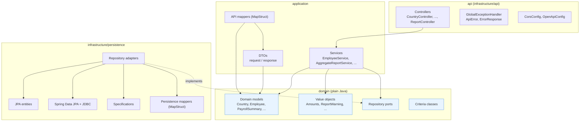

| Layer | Responsibility |
| :--- | :--- |
| `domain` | Models, value objects, enums, repository ports, criteria. Plain Java — no Spring, no JPA, no HTTP. |
| `application` | Services, use cases, orchestration. DTOs and API mappers. |
| `infrastructure.api` | REST controllers, error handling, CORS, OpenAPI config. |
| `infrastructure.persistence` | JPA entities, adapters, specifications, JDBC repositories, persistence mappers. |
| `common` | Pagination (`DataPage`, `Criteria`, `SortDirection`), validation (`DomainValidation`, `ValidationError`), exceptions (`ConflictException`, `ResourceNotFoundException`). |

Dependencies flow inward: `api` → `application` → `domain`. Infrastructure
implements interfaces the domain defines.

See `docs/clean-architecture.md` for the rules that keep the layering intact.

## Frontend Structure

| Folder | Responsibility |
| :--- | :--- |
| `core/` | HTTP interceptors, base services, shared models |
| `core/components/` | Shared UI components (confirm dialog, paginator) |
| `core/ui/` | Shared UI services (loading, toast) |
| `features/` | Feature areas: employee, payroll, reports, country, department, role |
| `layout/` | Header, sidebar |

State is managed with Angular signals. Components are standalone and use
OnPush change detection. There is no separate `shared/` folder — reusable
components live under `core/components/` and `core/ui/`, because the app is
small enough that a separate `shared/` layer would be a folder with one or
two files in it.

---

## Data Model

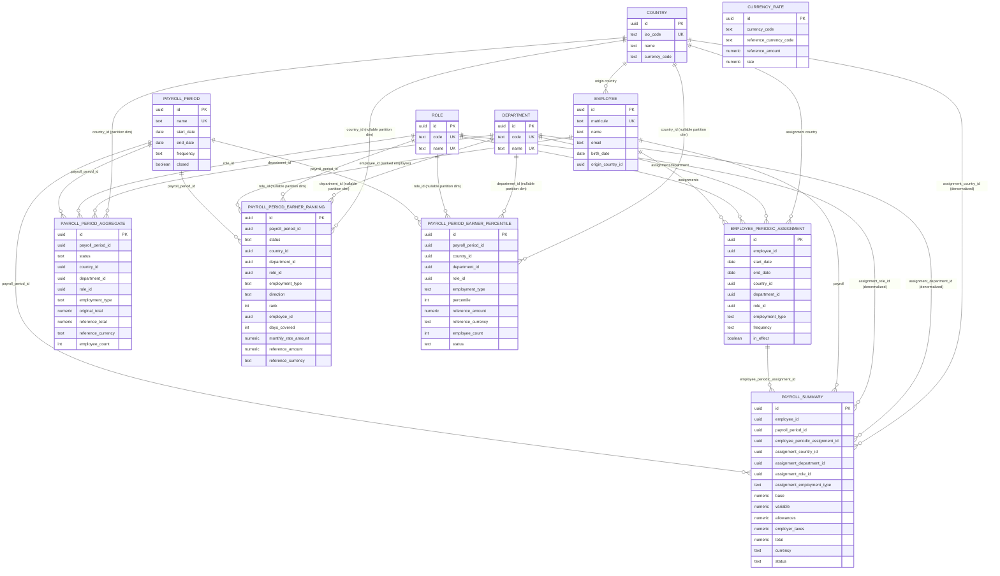

**Reading the diagram.** Only one edge pair is a real JPA association:
`PAYROLL_SUMMARY` → `EMPLOYEE` and `PAYROLL_SUMMARY` → `PAYROLL_PERIOD`
(the two `@ManyToOne` relations, which exist so the payroll list can sort
and filter without a per-row join). Every other edge is a UUID column
loaded explicitly by the adapter — the domain does not see a relation, only
a `UUID` that the adapter resolves.

**Two kinds of entity have no outgoing edges:**

- `CURRENCY_RATE` is a standalone lookup keyed by `(currency_code,
  reference_currency_code)`. It is read at report time to convert amounts,
  but no other table holds a foreign reference to it. A rate row is looked
  up by currency pair, not by row id.
- `PAYROLL_PERIOD_AGGREGATE`, `PAYROLL_PERIOD_EARNER_RANKING`, and
  `PAYROLL_PERIOD_EARNER_PERCENTILE` are snapshot outputs. They store
  denormalized UUIDs for `country`, `department`, `role`, `employee` — no
  adapter resolves them back into domain objects during a report read. The
  report reads the UUIDs and looks the labels up once per response, not per
  row.

**Money columns are abbreviated.** The aggregate table has eight money
columns (four `original_*` and four `reference_*`) plus two totals and two
currencies. The diagram shows only `original_total` and `reference_total`
to keep it readable. See `PayrollPeriodAggregateEntity` for the full column
list.

**Nullability of the partition dimensions.** On the three snapshot tables,
`country_id`, `department_id`, `role_id`, `employment_type` are all nullable,
because each row represents one of six partition kinds
(FULL / COUNTRY / DEPARTMENT / ROLE / EMPLOYMENT_TYPE / GLOBAL). A FULL row
sets all four; a COUNTRY row sets only `country_id`; the GLOBAL row sets
none. The partial unique indexes in the migrations enforce per-kind
uniqueness, because SQLite treats NULLs as distinct in a composite `UNIQUE`.

### Entities

| Entity | Purpose |
| :--- | :--- |
| **Country** | ISO code, name, currency code |
| **Department** | Canonical department list (stable `code` + display `name`) |
| **Role** | Canonical role list (stable `code` + display `name`) |
| **Employee** | Identity: matricule, name, email, birth date, origin country |
| **EmployeePeriodicAssignment** | Where and as what an employee worked, over a span of time |
| **PayrollPeriod** | Named date range with a frequency and a closed flag |
| **PayrollSummary** | Payroll record for an employee in a period, linked to an assignment |
| **CurrencyRate** | Current exchange rate for a currency pair |
| **PayrollPeriodAggregate** | Snapshot of totals by (period, country, department, role, employment type) |
| **PayrollPeriodEarnerRanking** | Snapshot of top and bottom earners, by partition and direction |
| **PayrollPeriodEarnerPercentile** | Snapshot of the 7-point distribution per partition |

### Value objects

| Object | Fields |
| :--- | :--- |
| **Amounts** | base, variable, allowances, employerTaxes, total, currency |
| **Amount** | amount, currency (single-amount variant used by rankings) |
| **ReportWarning** | code, severity, message, details |

`Amounts` is used by `PayrollSummary` and twice by `PayrollPeriodAggregate`
(`originalAmounts` and `referenceAmounts`). `Amount` is used by
`PayrollPeriodEarnerRanking` for `originalAmount`, `referenceAmount`, and
`monthlyRateAmount`.

### Enums

| Enum | Values |
| :--- | :--- |
| **EmploymentType** | `FULL_TIME`, `PART_TIME`, `CONTRACTOR` |
| **PayrollPeriodFrequency** | `MONTHLY`, `BI_WEEKLY` |
| **PayrollSummaryStatus** | `DRAFT`, `VALIDATED` |
| **EarnerRankingDirection** | `TOP`, `BOTTOM` |
| **GroupKey** | `COUNTRY`, `DEPARTMENT`, `ROLE`, `EMPLOYMENT_TYPE`, `CURRENCY`, `ORIGIN_COUNTRY` |
| **ReportKind** | `AGGREGATE`, `RANKING`, `COMPARISON` |
| **ReportWarningCode** | the stable codes surfaced in report warnings |

**`GroupKey` carries 7 values, but only 5 are usable for ranking.** The
ranking builder accepts `COUNTRY`, `DEPARTMENT`, `ROLE`, `EMPLOYMENT_TYPE`
(and the GLOBAL partition via `null`) and rejects `CURRENCY` and
`ORIGIN_COUNTRY` with `IllegalArgumentException`. The two rejected values
exist in the enum for symmetry with the aggregate report's group keys, where
`CURRENCY` is also rejected at the statistics builder and `ORIGIN_COUNTRY`
is rejected at the validation layer. They are placeholders, not features.

### Field detail — Employee

| Field | Type | Constraint |
| :--- | :--- | :--- |
| id | UUID | PK, assigned by the domain |
| matricule | String | Unique, required, business key |
| name | String | Required |
| email | String | Required, RFC 5321 max length |
| birthDate | LocalDate | Nullable |
| originCountryId | UUID → Country | Nullable |

### Field detail — Department

| Field | Type | Constraint |
| :--- | :--- | :--- |
| id | UUID | PK |
| code | String | Unique, required, 2..10 chars |
| name | String | Unique, required, 2..100 chars |

### Field detail — Role

Same shape as Department.

### Field detail — EmployeePeriodicAssignment

| Field | Type | Constraint |
| :--- | :--- | :--- |
| id | UUID | PK |
| employeeId | UUID | Required |
| startDate | LocalDate | Required |
| endDate | LocalDate | Nullable, must be after startDate |
| country | Country | Required |
| department | Department | Required |
| role | Role | Required |
| employmentType | EmploymentType | Required |
| payrollFrequency | PayrollPeriodFrequency | Required |
| inEffect | boolean | At most one `true` per employee |

`payrollFrequency` on the assignment is the cadence at which this placement
is paid. Payroll periods are matched to assignments by this frequency: a
`MONTHLY` assignment only produces payroll summaries in monthly periods, a
`BI_WEEKLY` assignment only in bi-weekly periods. This is what lets the two
cadences coexist without conflicting.

### Field detail — PayrollPeriod

| Field | Type | Constraint |
| :--- | :--- | :--- |
| id | UUID | PK |
| name | String | Unique |
| startDate | LocalDate | Required, before endDate |
| endDate | LocalDate | Required |
| frequency | PayrollPeriodFrequency | Required |
| closed | boolean | Default `false` |

### Field detail — PayrollSummary

| Field | Type | Constraint |
| :--- | :--- | :--- |
| id | UUID | PK |
| employee | EmployeeEntity (`@ManyToOne`) | Required |
| payrollPeriod | PayrollPeriodEntity (`@ManyToOne`) | Required |
| employeePeriodicAssignmentId | UUID | Required |
| assignmentCountryId | UUID | Denormalized from assignment |
| assignmentDepartmentId | UUID | Denormalized from assignment |
| assignmentRoleId | UUID | Denormalized from assignment |
| assignmentEmploymentType | EmploymentType | Denormalized from assignment |
| amounts | Amounts | Required |
| status | PayrollSummaryStatus | Default `DRAFT` |

**The four denormalized assignment columns** exist so the payroll list can
filter and sort by assignment attributes without a join. The duplication is
safe because the assignment's placement is frozen once payroll exists — the
service rejects structural changes to an assignment after any summary
references it.

**The two `@ManyToOne` relations** are the single documented exception to the
"no JPA relations" rule. The payroll list needs to sort by `employee.name`
and filter by `payrollPeriod.startDate`. A subquery per row would be slow at
10,000 employees.

### Field detail — PayrollPeriodAggregate

| Field | Type | Constraint |
| :--- | :--- | :--- |
| id | UUID | PK |
| payrollPeriodId | UUID | Required |
| status | PayrollSummaryStatus | Required |
| countryId | UUID | Required |
| departmentId | UUID | Required |
| roleId | UUID | Required |
| employmentType | EmploymentType | Required |
| originalAmounts | Amounts | Required, in assignment currency |
| referenceAmounts | Amounts | Required, in reference currency |
| employeeCount | Integer | Required, non-negative |

Unique: `(payrollPeriodId, countryId, departmentId, roleId, employmentType)`.

Note this unique key has **five** columns including `employmentType`. The
aggregate table stores the finest granularity the data supports; reports
group from it into whichever dimensions the user selects.

### Field detail — PayrollPeriodEarnerRanking

| Field | Type | Constraint |
| :--- | :--- | :--- |
| id | UUID | PK |
| payrollPeriodId | UUID | Required |
| status | PayrollSummaryStatus | Required |
| countryId | UUID | Nullable |
| departmentId | UUID | Nullable |
| roleId | UUID | Nullable |
| employmentType | EmploymentType | Nullable |
| direction | EarnerRankingDirection | Required |
| rank | Integer | Required |
| employeeId | UUID | Required |
| daysCovered | Integer | Number of labor days the raw sum covers |
| originalAmount | Amount | In assignment currency |
| referenceAmount | Amount | In reference currency |
| monthlyRateAmount | Amount | Ranking key, normalized to a monthly rate |

Unique: `(payrollPeriodId, countryId, departmentId, roleId, employmentType,
direction, rank)`.

**Nullable dimension columns** are how the table represents six partition
kinds:

- **FULL**: all four dimensions set (the richest partition).
- **COUNTRY**: only `countryId` set, the rest null.
- **DEPARTMENT**: only `departmentId` set.
- **ROLE**: only `roleId` set.
- **EMPLOYMENT_TYPE**: only `employmentType` set.
- **GLOBAL**: all four null.

The partial unique indexes in the migration enforce per-kind uniqueness,
because SQLite treats NULLs as distinct in a composite UNIQUE constraint and
would otherwise let the GLOBAL partition have duplicate ranks.

### Field detail — PayrollPeriodEarnerPercentile

| Field | Type | Constraint |
| :--- | :--- | :--- |
| id | UUID | PK |
| payrollPeriodId | UUID | Required |
| countryId | UUID | Nullable |
| departmentId | UUID | Nullable |
| roleId | UUID | Nullable |
| employmentType | String | Nullable |
| percentile | Integer | 0–100, one of {0, 10, 25, 50, 75, 90, 100} |
| referenceAmount | BigDecimal | Annualized, in reference currency |
| referenceCurrency | String | Required |
| employeeCount | Integer | The group size at snapshot time |
| status | PayrollSummaryStatus | Required |

Unique: `(payrollPeriodId, countryId, departmentId, roleId, employmentType,
percentile)` — 7 rows per partition.

**`percentile` is stored as `0, 10, 25, 50, 75, 90, 100`**, not as 0..100
increments. Each value marks the boundary between population deciles. The
values are **annualized** (`monthly_rate × 12`) so they can be compared
across cadences and displayed as "this salary sits at the Nth percentile of
annual compensation."

### Field detail — CurrencyRate

| Field | Type | Constraint |
| :--- | :--- | :--- |
| id | UUID | PK |
| currencyCode | String | Required, 3 chars |
| referenceCurrencyCode | String | Required, 3 chars |
| referenceAmount | BigDecimal | Required, strictly positive |
| rate | BigDecimal | Required, strictly positive |

Unique: `(currencyCode, referenceCurrencyCode)`.

**Reading a row as a sentence:** `referenceAmount referenceCurrencyCode =
rate currencyCode`. Example: `(1, 'USD', 583.51, 'XAF')` reads "1 USD =
583.51 XAF"; `(100, 'JPY', 0.65, 'USD')` reads "100 JPY = 0.65 USD".

**Conversion (general formula):**

```
amount_in_reference  = amount_in_foreign × reference_amount / rate
amount_in_currency   = amount_in_reference × rate / reference_amount
```

**Invariant today:** every seeded rate row carries `reference_amount = 1`
and `reference_currency_code = 'USD'`, so the formula reduces to
`amount_in_USD = amount_in_foreign / rate` for non-USD currencies, and USD
is identity. The schema and the query layer are written against the general
formula; the seed's `reference_amount = 1` is a convenience, not a schema
assumption.

**Self-pair invariant:** a row where `currencyCode = referenceCurrencyCode`
must have `reference_amount = 1` and `rate = 1`. Enforced by triggers in
`V1__initial_schema.sql`.

**Single-reference-currency invariant:** at any moment, every row in the
table carries the same `referenceCurrencyCode`. Enforced by triggers.

### PayrollPeriodSnapshot — domain-only

`PayrollPeriodSnapshot` is **not persisted**. It is a transient view
assembled from the aggregates, rankings, and percentiles of a period for a
given status. It has no table, no repository, no id.

```
PayrollPeriodSnapshot
├── payrollPeriod
├── List<PayrollPeriodAggregate>
├── List<PayrollPeriodEarnerRanking>
└── List<PayrollPeriodEarnerPercentile>
```

The status lives on each row, not on the snapshot. This removes a join and
lets the snapshot be assembled by one filtered query per table.

---

## Key Relationships

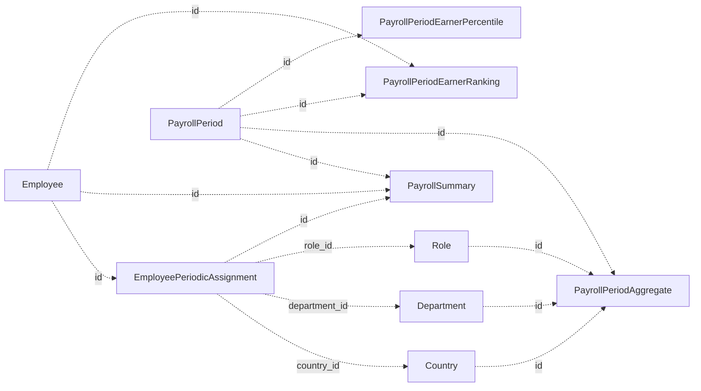

Dashed arrows are UUID columns, not JPA relations. Only `PayrollSummary`
uses JPA relations (two `@ManyToOne`); every other foreign reference is a
UUID column loaded explicitly by the adapter.

---

## Key Constraints

- `Country.isoCode` unique
- `Department.code`, `Department.name` unique
- `Role.code`, `Role.name` unique
- `Employee.matricule` unique
- `PayrollPeriod.name` unique
- `PayrollPeriod.startDate` before `PayrollPeriod.endDate`
- `PayrollPeriod.frequency` matches duration (monthly 28–31 days, bi-weekly 14)
- Periods of the same frequency do not overlap
- At most one `EmployeePeriodicAssignment.inEffect = true` per employee
- `EmployeePeriodicAssignment` ranges do not overlap per employee
- `PayrollSummary` unique per `(employee, payrollPeriod)`
- `PayrollSummary.total = base + variable + allowances + employerTaxes`
  (enforced with `ROUND(..., 2)` to survive SQLite's REAL storage)
- `PayrollSummary.currency` matches the assignment's country currency
- `PayrollSummary`'s period falls entirely within the assignment's date range
- Validated payroll summaries are immutable
- Payroll summaries cannot be created for closed periods
- `PayrollPeriodAggregate` unique per `(period, country, department, role, employmentType)`
- `PayrollPeriodEarnerRanking` unique per `(period, partition, direction, rank, status)`
- `PayrollPeriodEarnerPercentile` unique per `(period, partition, percentile, status)`
- `CurrencyRate` unique per `(currency, reference currency)`
- `CurrencyRate` self-pairs must be identity
- `CurrencyRate` uses a single `referenceCurrencyCode` across all rows

### Not enforced by the database

- Overlap prevention for payroll periods is enforced in the service layer.
  SQLite does not support exclusion constraints.
- For a given employee, payroll summaries do not cover overlapping date
  ranges. Prevented by construction: at most one in-effect assignment exists
  at a time, and payroll summaries can only be created against the in-effect
  assignment.

---

## Validation at Save Time

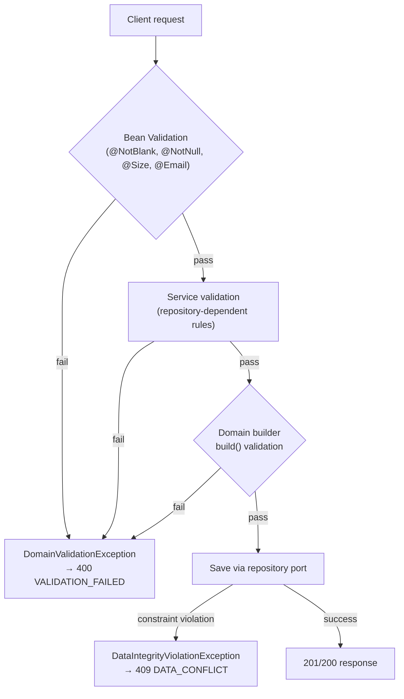

**Employee**
- Matricule unique
- Required fields present
- Creation requires an assignment
- Update guards:
    - Cannot close and update the same assignment in one request
    - End date on the in-effect assignment must not precede the latest linked
      payroll period's start date
    - Cannot create a new in-effect assignment without closing the existing one
      in the same request
    - Structural changes to an assignment are rejected once payroll exists

**EmployeePeriodicAssignment**
- Start before end (when end is present)
- No overlap with the same employee's other assignments
- At most one `inEffect = true` per employee
- Creating a new assignment sets the previous one's `inEffect` to false

**PayrollPeriod**
- Name unique
- Start before end
- Frequency matches duration
- No overlap with another period of the same frequency
- Editable or deletable only when no payroll exists

**PayrollSummary**
- `(employee, payrollPeriod)` unique
- Components non-negative
- Total equals the sum of components (with scale-2 rounding to survive REAL)
- Assignment belongs to the same employee
- Period falls entirely within the assignment's date range
- Currency matches the assignment's country currency
- Period is open

**Payroll recording — in-effect assignment check**
- The in-effect assignment's date range must cover the payroll period
- If it does not, recording cannot continue
- The system explains why and offers two ways to resolve it:
    - Extend the assignment's end date
    - Create a new assignment
- Recording continues once the assignment covers the period

---

## Data Quality at Report Time

- **Blockers:** missing FX rate for a currency used in the period; invalid
  date range; future period; unvalidated payroll summaries in the period;
  no reference currency configured.
- **Warnings:** employees with an in-effect assignment but no validated
  payroll summary; partial country coverage.

### Entry vs. reporting

- **Entry** is strict. A payroll summary that contradicts an assignment is
  rejected. Closed periods reject new summaries. The reason is always
  explained.
- **Reporting** is lenient. Gaps in the data do not block the report; they
  are surfaced as warnings.

---

## Snapshot Design

A snapshot is the aggregation of a period: totals, rankings, and percentiles,
stored per period and per status. Reports read snapshots.

### How snapshots are stored

There is **no snapshot table**. The three snapshot outputs are:

- `PayrollPeriodAggregate` — one row per `(period, country, department,
  role, employmentType)`, with `original_*` and `reference_*` amount pairs
  and `employee_count`.
- `PayrollPeriodEarnerRanking` — up to 5 TOP and 5 BOTTOM rows per partition
  and direction, with `daysCovered`, `originalAmount`, `referenceAmount`,
  and `monthlyRateAmount`.
- `PayrollPeriodEarnerPercentile` — 7 rows per partition (one per percentile
  label `0, 10, 25, 50, 75, 90, 100`), with `referenceAmount` annualized.

All three tables carry `payroll_period_id` and `status`, and all three are
indexed by `(payroll_period_id)` plus the relevant partition dimension.

To read a period's snapshot at a given status:

```sql
SELECT * FROM payroll_period_aggregates
WHERE payroll_period_id = ? AND status = ?;

SELECT * FROM payroll_period_earner_rankings
WHERE payroll_period_id = ? AND status = ?;

SELECT * FROM payroll_period_earner_percentiles
WHERE payroll_period_id = ? AND status = ?;
```

Three queries, no join. The status discriminator lets a report find either
the DRAFT or VALIDATED snapshot for a period.

### Snapshot lifecycle

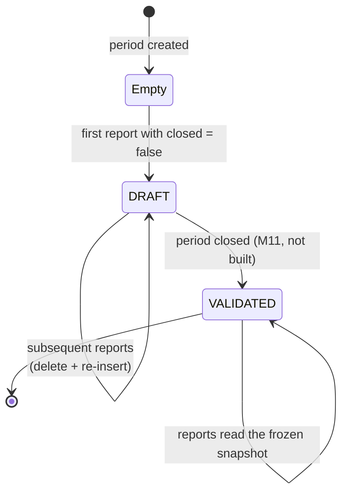

The lifecycle is driven by the period's `closed` flag:

- **Open period (`closed = false`).** The snapshot is **rebuilt on every
  read** from the live payroll summaries. The rows are written with
  `status = DRAFT` and replace the previous DRAFT rows for the period.
  Reports always read the freshest snapshot. Rebuilds are cheap for a
  period and never touch VALIDATED rows.
- **Closed period (`closed = true`).** The snapshot was frozen at close
  time, written with `status = VALIDATED`, and is **read-only**. No rebuild
  runs, and reports read the frozen rows.

The design assumes HR closes periods gradually: report against open periods
throughout the month, then close the period when the payroll is settled.
From that moment, the report for that period is a stable record of what was
paid.

**Why DRAFT and VALIDATED exist on snapshot rows.** The two statuses encode
whether a snapshot is final for its period:

- **`DRAFT`** — the period is **not yet closed**. The HR manager is still
  recording payroll in that period, and the snapshot can change on the next
  read. Reports treat DRAFT snapshots as provisional: they are rebuilt
  before being read, so the report always reflects the current state of the
  period.
- **`VALIDATED`** — the period **has been closed**. Its payroll is final and
  accurate. The snapshot is the record of what was paid, and it is not
  rebuilt. Reports read VALIDATED snapshots as-is.

The status is what tells a reader of the report whether the numbers they are
looking at are "the current state of an in-progress period" or "the final
record of a settled period." That distinction is the whole point of the
closed flag on `PayrollPeriod`, and the status on the snapshot rows is how
it propagates into the snapshot tables

# Continuation of `docs/architecture.md`

```markdown
**Today, the close flow is not built.** `M11` is 0/4. All seeded closed
periods have `VALIDATED` snapshots; all seeded open periods have no snapshot
rows until a report triggers a rebuild, which writes `DRAFT`. The status
column and the status-in-unique-key design are the mechanism for the close
flow to set `VALIDATED` when a period is closed — the transition itself is
what's missing, not the machinery.

**Why DRAFT and VALIDATED coexist on payroll summaries (a separate
concept).** The two statuses on `PayrollSummary` are the HR manager's
working state on a per-row basis:

- A summary is created as `DRAFT`. It can be edited or deleted.
- When the HR manager validates it, it becomes `VALIDATED` and immutable.
  Corrections after validation are out of scope.

Snapshot rebuilds only read `VALIDATED` summaries. DRAFT summaries are
invisible to the snapshot — they exist in the payroll list for the HR
manager to work on, but they don't contribute to any reported total until
they are validated. This is why the snapshot build treats a period with
unvalidated summaries as blocked (`UNVALIDATED_PAYROLL_SUMMARY`): a report
cannot be produced from an incomplete payroll, because the totals would be
wrong.

**The two concepts are different.** A `PayrollSummary` is DRAFT or VALIDATED
depending on whether the HR manager has finished entering that one row. A
snapshot row is DRAFT or VALIDATED depending on whether the period it
belongs to has been closed. They are related — a period can only be closed
once every summary in it is VALIDATED — but they are not the same status,
and the code keeps them separate. `PayrollSummary.status` describes a
payroll row; `PayrollPeriodAggregate.status`,
`PayrollPeriodEarnerRanking.status`, and
`PayrollPeriodEarnerPercentile.status` describe a snapshot.

### How the report builds snapshots

The two snapshot kinds are rebuilt independently. The aggregate report
rebuilds aggregates only; the ranking report rebuilds rankings and
percentiles only. Neither path touches the other's tables.

#### Aggregate rebuild — `buildAndSaveAggregates(period)`

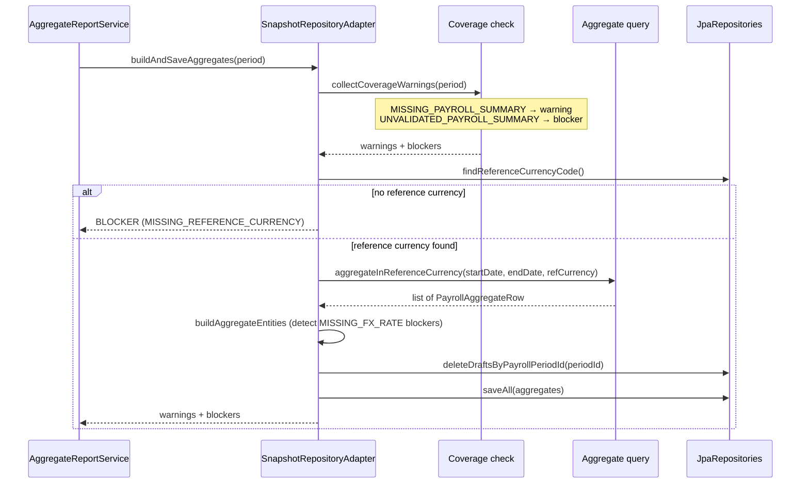

#### Ranking + percentile rebuild — `buildAndSaveRankings(period)`

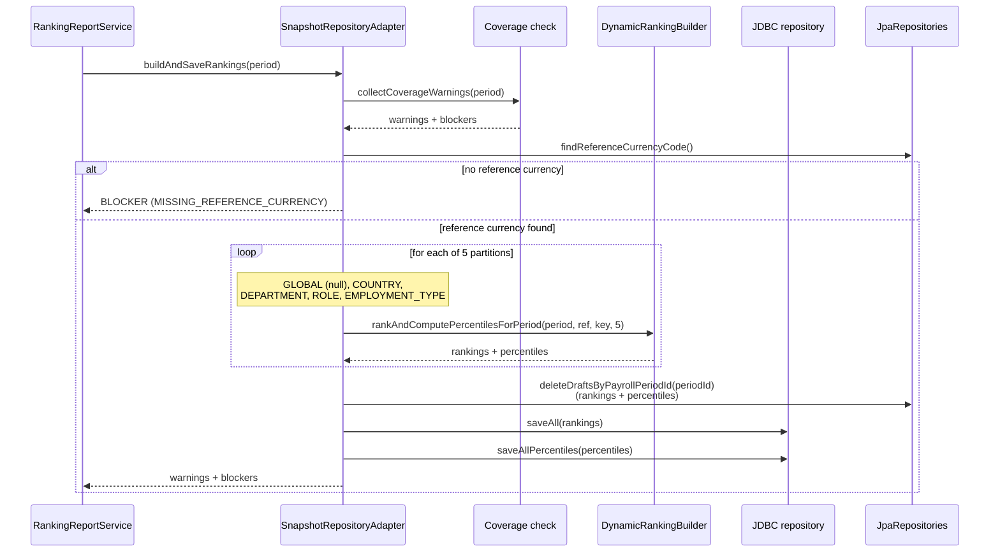

**Coverage warnings are collected on every rebuild.** Before the snapshot
build runs, `collectCoverageWarnings` scans the period for:

- **Employees with an in-effect assignment but no payroll summary** — a
  `WARNING` (`MISSING_PAYROLL_SUMMARY`). The rebuild proceeds; the report
  may be incomplete but it is not wrong.
- **Payroll summaries still in DRAFT status** — a `BLOCKER`
  (`UNVALIDATED_PAYROLL_SUMMARY`). The report is not produced. The HR
  manager must validate or delete the drafts first.

Both are collected once, at the start of the rebuild, and returned in the
result regardless of whether the rebuild succeeds. The report service
carries the warnings into the response; if there is a blocker, the report
service throws `ReportBlockedException` before any read.

**Blockers are all-or-nothing per period.** If a period's rebuild produces
any blocker (`MISSING_REFERENCE_CURRENCY`, `MISSING_FX_RATE`, or
`UNVALIDATED_PAYROLL_SUMMARY`), the existing DRAFT rows are **not** deleted
and no new rows are written. The period's snapshot stays at its previous
state, and the report service aborts. The report is not produced.

**Deletion happens after the build.** Both `saveAggregates` and
`saveEarnerRankings` call `deleteDraftsByPayrollPeriodId(periodId)` before
inserting. This is the delete-and-replace step. VALIDATED rows are never
touched — the delete method targets `DRAFT` only. That is what lets a
period with both statuses coexist (see the lifecycle section above).

**Rankings and percentiles are built in one pass.** The
`DynamicRankingBuilder.rankAndComputePercentilesForPeriod` returns both as a
single `RankingAndPercentileResult`. The rebuild loop runs it once per
partition (5 partitions: GLOBAL, COUNTRY, DEPARTMENT, ROLE,
EMPLOYMENT_TYPE) and accumulates both lists across all 5 calls before a
single delete-and-insert. This keeps the ranking report consistent: all 5
partition kinds are always written together, never partially.

**Rebuild scope is decided by the caller.** The snapshot adapter rebuilds
whatever period it is handed. The invariant "only open periods are rebuilt"
lives in the report services:

- `AggregateReportService.generate` filters to periods where `closed = false`
  before calling `buildAndSaveAggregates`.
- `RankingReportService.doGenerate` checks `period.closed` and calls
  `buildAndSaveRankings` only when the period is open.

The adapter is a pure mechanism: build the snapshot for this period, save
it, return the warnings and blockers. The policy — rebuild only when the
period is open — is in the service layer where it belongs.

### Snapshot IDs

Snapshot rows are created with random UUIDs, not deterministic seed-style
IDs. A rebuild deletes the period's DRAFT rows and re-inserts new ones; the
random IDs make "this is a new snapshot" explicit and keep the DRAFT rows
distinguishable from the immutable VALIDATED rows written at period close.

A rebuild is therefore **not idempotent in IDs** but is **idempotent in
content**: two consecutive rebuilds of the same period produce the same
logical rows with different primary keys. Callers that cache snapshot IDs
must refresh after a rebuild.

### Why per-period, not cumulative

Each snapshot holds the totals for its period only. A report over a range
sums the snapshots in the range. At this scale — tens of periods, hundreds
of combination rows per period — summing is trivial. Cumulative snapshots
would add complexity for no benefit.

### Snapshot growth

For each period, the aggregate table has one row per observed
`(country, department, role, employmentType)` combination. With 10
countries, 10 departments, 12 roles, and 2 employment types, the number of
combinations that actually occur is bounded and small (a few hundred per
period). The ranking table adds up to 10 rows per partition (5 TOP + 5
BOTTOM per direction, across six partition kinds). The percentile table adds
7 rows per partition. Over a year of monthly and bi-weekly periods, this is
on the order of tens of thousands of rows — negligible.

---

## Report Model

Reports fall into three kinds in the model. Only the first two are built.

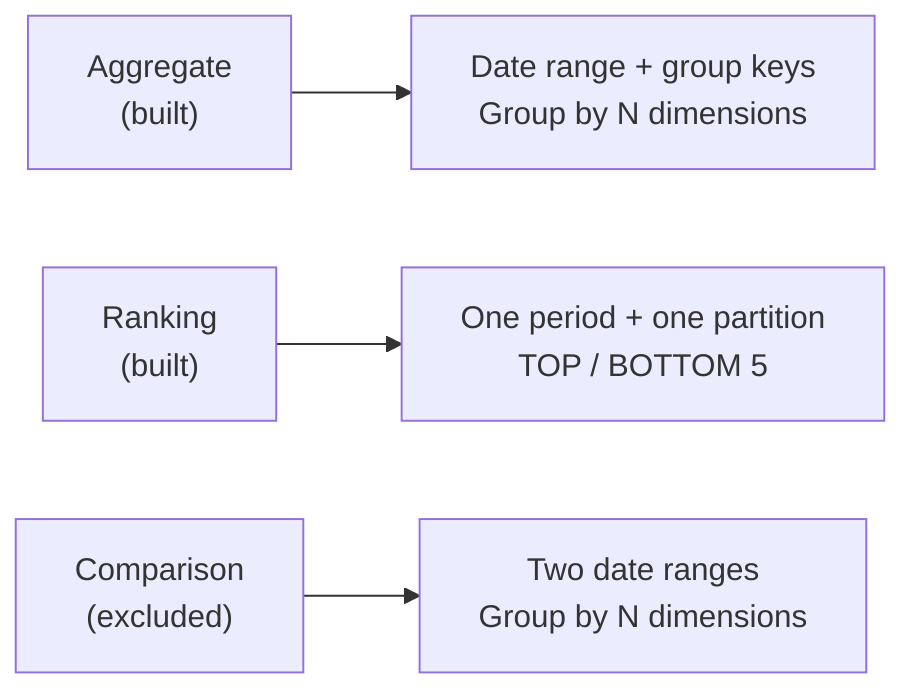

### Group keys

| Key | Source | Usable for |
| :--- | :--- | :--- |
| `COUNTRY` | Assignment → Country | Aggregate group key, ranking partition |
| `DEPARTMENT` | Assignment → Department | Aggregate group key, ranking partition |
| `ROLE` | Assignment → Role | Aggregate group key, ranking partition |
| `EMPLOYMENT_TYPE` | Assignment → EmploymentType | Aggregate group key, ranking partition |
| `CURRENCY` | PayrollSummary.currency | Rejected everywhere |
| `ORIGIN_COUNTRY` | Employee → Country | Rejected everywhere |

`totalSalary` is not a group key. It is the measure returned by every
aggregate report, in the reference currency.

**Unsupported group keys.** `CURRENCY` is rejected by
`DynamicStatisticsBuilder` (statistics cannot be computed per currency
because each summary is already in one currency). `ORIGIN_COUNTRY` is
rejected at validation time because `PayrollPeriodAggregate` does not carry
the employee's origin country. Requesting either returns
`VALIDATION_FAILED` with `UNSUPPORTED_GROUP_KEY`.

### Shared types

**DateRange**
```
{ startDate: LocalDate, endDate: LocalDate }
```

**Amount**
```
{ amount: BigDecimal, currency: String }
```

**Amounts**
```
{ base: BigDecimal, variable: BigDecimal, allowances: BigDecimal,
  employerTaxes: BigDecimal, total: BigDecimal, currency: String }
```

**ReportWarning**
```
{
  code: string,
  severity: BLOCKER | WARNING,
  message: string,
  details?: object
}
```

### Type 1 — Aggregate report (built)

**Request**
```
{
  kind: "AGGREGATE",
  dateRange: DateRange,
  groupKeys: GroupKey[],
  includeBreakdown: boolean,
  includeStatistics: boolean
}
```

**Response**
```
{
  kind: "AGGREGATE",
  dateRange: DateRange,
  groupKeys: GroupKey[],
  referenceCurrency: string,
  lines: [ AggregateLine ],
  warnings: ReportWarning[]
}
```

**AggregateLine**
```
{
  amount: Amount,
  employeeCount: number,
  country?: string,
  department?: string,
  role?: string,
  employmentType?: string,
  currency?: string,
  originCountry?: string,
  breakdown?: Amounts,
  statistics?: StatisticsDto
}
```

**StatisticsDto** (per-frequency shape in the current code):
```
{
  monthly?: StatisticsPerFrequency,
  biWeekly?: StatisticsPerFrequency
}
```

**StatisticsPerFrequency**
```
{
  min: Amount,
  max: Amount,
  average: Amount,
  total: Amount,
  employeeCount: number,
  periodCount: number
}
```

**Constraints**
- `statistics` requires **at most one** group key. Multiple keys return
  `VALIDATION_FAILED`.
- Statistics are computed **per frequency** — monthly and bi-weekly
  distributions are separate. Mixing them would average a bi-weekly
  paycheck with a monthly one, which is meaningless.
- Lines are sparse: only the requested group key values are populated.
- Empty `groupKeys` returns a single total line.
- **When `includeStatistics=true`, the line's `amount` becomes the sum of
  the monthly total and the bi-weekly total.** This replaces the aggregate
  row's total, which is a subtle behavior worth noting.

### Type 2 — Ranking report (built)

**Request**
```
{
  kind: "RANKING",
  periodId: UUID,
  groupKey: GroupKey | null,
  countryId?: UUID,
  departmentId?: UUID,
  roleId?: UUID,
  employmentType?: "FULL_TIME" | "PART_TIME" | "CONTRACTOR",
  direction: "TOP" | "BOTTOM",
  limit: number
}
```

The `groupKey` and dimension fields must agree: `groupKey = COUNTRY`
requires `countryId` and forbids `departmentId`, `roleId`,
`employmentType`. `groupKey = null` requires all four dimension fields to be
null (the GLOBAL partition). Any mismatch returns `VALIDATION_FAILED`.

**Response**
```
{
  kind: "RANKING",
  period: PayrollPeriodResponse,
  referenceCurrency: string,
  groupKey: GroupKey | null,
  tops: [ EarnerRankingDto ],
  bottoms: [ EarnerRankingDto ],
  warnings: ReportWarning[],
  positionContext?: PositionContextDto,
  totalReferenceAmount: BigDecimal,
  totalDimensionReferenceAmount: BigDecimal,
  totalMonthlyPeriod: 0 | 1,
  totalBiWeeklyPeriod: 0 | 1
}
```

**EarnerRankingDto**
```
{
  rank: number,
  monthlyReferenceAmount: BigDecimal,
  frequency: PayrollPeriodFrequency,
  percentile: number | null,   // in basis points (0..10000)
  employee: { id, matricule, name },
  country: { id, code, name } | null,
  department: { id, code, name } | null,
  role: { id, code, name } | null,
  employmentType: EmploymentType | null,
  period: PayrollPeriodResponse
}
```

**PositionContextDto**
```
{
  employeeCount: number,
  min: BigDecimal,
  p10: BigDecimal,
  p25: BigDecimal,
  p50: BigDecimal,
  p75: BigDecimal,
  p90: BigDecimal,
  max: BigDecimal
}
```

**Ranking unit.** Rows are ranked by **monthly rate**, not raw amount. Each
summary's contribution to the monthly rate is `total / daysCovered`, where
`daysCovered` is `daysInMonth` for a MONTHLY summary and `14` for a
BI_WEEKLY summary. The monthly rate for an employee in the period is
`(SUM(total) / SUM(daysCovered)) × daysInMonth`. This makes a bi-weekly
check comparable to a monthly one for ranking purposes.

**Percentiles.** The 7-point distribution (min, p10, p25, p50, p75, p90,
max) is stored **annualized** — i.e., the monthly rate × 12. The report
interpolates the earner's percentile from this annualized distribution and
expresses it in basis points (0–10000).

**BOTTOM display rank inversion.** Stored BOTTOM ranks are 1 = lowest
earner. The service converts them to `totalEmployees - rank + 1` so the UI
can display a position N of M consistently with TOP ranks.

**Assignment fallback.** For each ranked employee, the service looks up the
employee's assignment **as of the period**. If found, it uses the
assignment's country/department/role/employmentType — which reflects where
the person *was* during the period. If the assignment has since changed, the
ranking row's stored dimension columns are the fallback. This keeps
historical reports correct after an employee moves.

**Constraints**
- `limit` is capped at 5 by the builder.
- The report is period-scoped, not range-scoped.

### Type 3 — Comparison report (deliberately excluded)

The `ReportKind.COMPARISON` enum value exists, and `docs/use-cases.md`
describes the intended flow, but **no code produces it**. The
`ComparisonReport` request/response shape is preserved in this document for
reference:

**Request**
```
{
  kind: "COMPARISON",
  dateRange1: DateRange,
  dateRange2: DateRange,
  groupKeys: GroupKey[]
}
```

**Response**
```
{
  kind: "COMPARISON",
  groupKeys: GroupKey[],
  referenceCurrency: string,
  lines: [ ComparisonLine ],
  warnings: ReportWarning[]
}
```

**ComparisonLine**
```
{
  country?: string,
  department?: string,
  role?: string,
  employmentType?: string,
  currency?: string,
  originCountry?: string,
  period1: { amount: Amount, employeeCount: number },
  period2: { amount: Amount, employeeCount: number },
  delta: Amount,
  deltaPercent: number | null
}
```

**Why it is not built.** The aggregate report already exercises the full
snapshot pipeline: grouping, filtering, statistics, warnings, blockers. A
comparison report is the same machinery applied twice and joined. It would
not reveal anything new about the design and would add surface area for no
proportionate gain. See `docs/planning.md` for the exclusion reasoning.

### API endpoints

**Built:**
```
POST /api/v1/reports/aggregate
POST /api/v1/reports/rankings
```

**Not built** (documented for completeness):
```
POST /api/v1/reports/comparison    // excluded
```

Note: the built endpoint is `/reports/rankings` (plural), not `/ranking`.

---

## Data Flow

### Create an employee

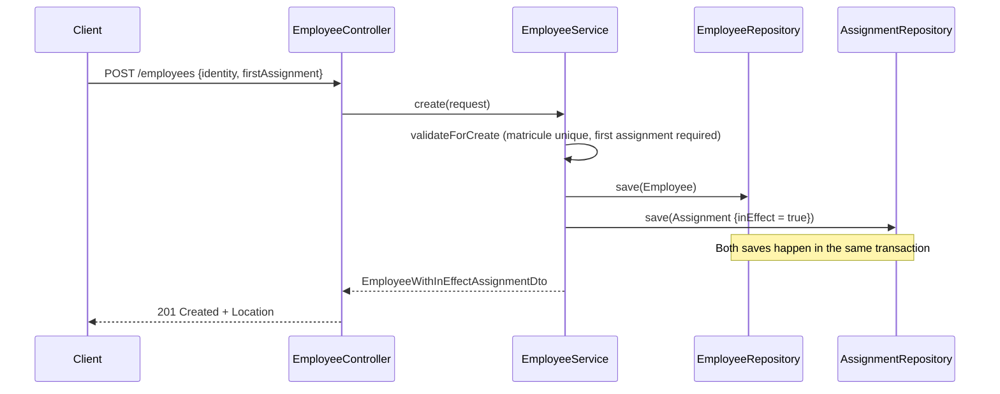

### Update an employee (three-way atomic decision)

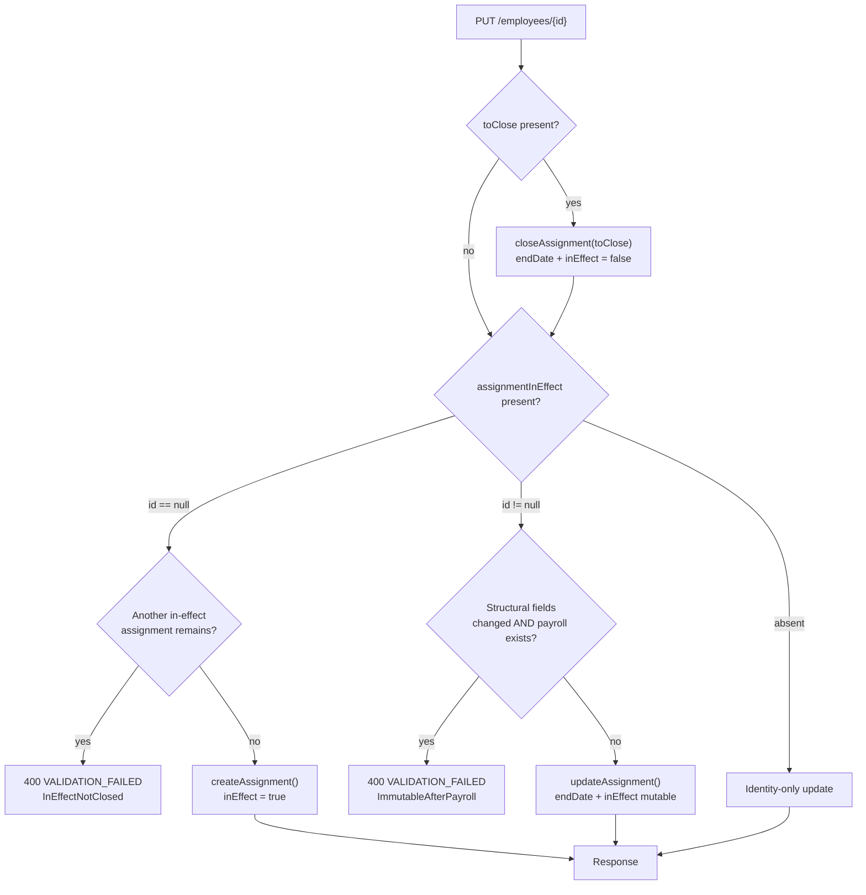

The service validates that `toClose.id != assignmentInEffect.id` (you cannot
close and update the same assignment in one request) before any of this
runs. All state changes happen in one transaction.

### Save a payroll summary

1. Client sends employee, payroll period, amounts.
2. Backend resolves the employee's in-effect assignment.
3. Backend checks the assignment covers the payroll period.
    - If not, the request fails with an explanation and fix options.
4. Backend validates structural rules.
5. Backend verifies the currency matches the assignment's country currency.
6. Backend verifies the period is open.
7. The summary is saved in `DRAFT` status.

### Validate a payroll summary (single or bulk)

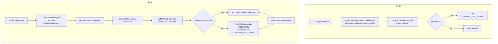

Bulk validation is **not atomic**: successful rows commit, failures are
reported. It uses **keyset pagination** (a cursor) so shrinking working sets
don't skip rows, and a **reconciliation query** to catch rows that lost a
race between the read and the update.

### Close a payroll period

> **Not built.** `M11` is 0/4. The flow below is the intended design.

1. Client requests the close.
2. Backend verifies all summaries in the period are `VALIDATED`.
3. Backend builds the snapshot: aggregates, rankings, percentiles.
4. Backend stores them with `status = VALIDATED` (replacing any existing
   DRAFT rows for the period).
5. The period is marked `closed = true`.

### Generate a report

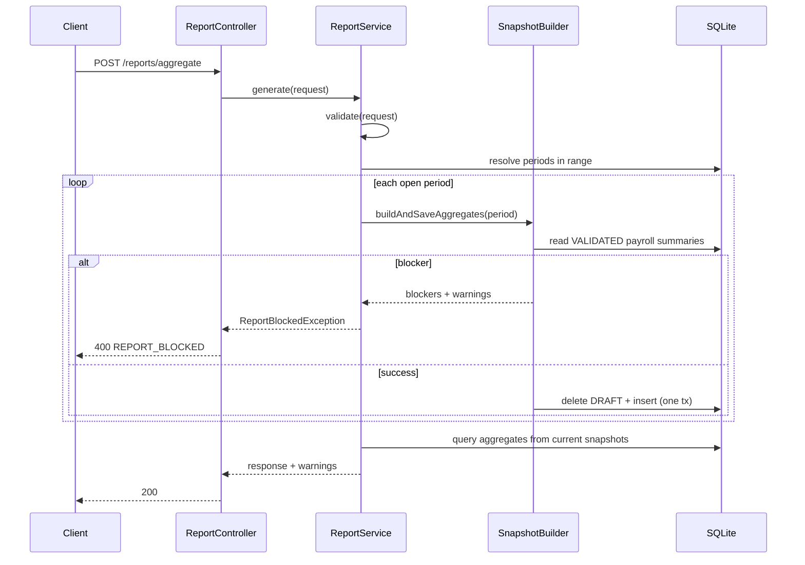

---

## Cross-Cutting Concerns

### Validation

- **Field-level:** Jakarta Bean Validation on DTOs and domain models
  (`@NotBlank`, `@NotNull`, `@Size`, `@Email`).
- **Cross-field:** checked in the domain builder's `build()` method, which
  calls `DomainValidation.validate(object, extraErrors)`.
- **Repository-dependent:** checked in the service, because the domain object
  cannot reach the repository (e.g. "is this matricule already taken?").
- **Failures** throw `DomainValidationException`, carrying a
  `List<ValidationError>`. The exception handler maps it to a 400 with the
  `errors` array intact.

### Error handling

A global exception handler (`GlobalExceptionHandler`) maps domain exceptions
to HTTP status codes and a consistent envelope:

| Exception | HTTP | `code` |
| :--- | :--- | :--- |
| `DomainValidationException` | 400 | `VALIDATION_FAILED` |
| `ReportBlockedException` | 400 | `REPORT_BLOCKED` |
| `MethodArgumentNotValidException` | 400 | `INVALID_REQUEST` |
| `IllegalArgumentException` | 400 | `INVALID_REQUEST` |
| `HttpMessageNotReadableException` | 400 | `INVALID_REQUEST` |
| `ResourceNotFoundException` | 404 | `NOT_FOUND` |
| `DataIntegrityViolationException` | 409 | `DATA_CONFLICT` |
| `ConflictException` | 409 | `DATA_CONFLICT` |
| Any other `Exception` | 500 | `INTERNAL_ERROR` |

Blocked operations always explain why and what to do. `ReportBlockedException`
carries both blockers (severity `ERROR`) and warnings (severity `WARNING`) in
the same response — blockers prevent the report, warnings do not.

Constraint violations (`DataIntegrityViolationException`) map to **409**, not
500, because most of them are caller errors (duplicate matricule, deleting a
referenced row). The handler extracts the constraint name from the driver
message and includes it in `details.constraint`.

### Logging

- SLF4J + Logback, Spring Boot defaults.
- Services log at `INFO` for state changes (created, validated, blocked) and
  at `DEBUG` for read operations (listing, paging).
- Error logging preserves context: `RankingReportService` logs the
  `periodId`, `groupKey`, and dimension on failure before re-throwing.
- Bulk operations log per-batch progress: rows processed, rows succeeded,
  rows failed.

### Configuration

- Environment-driven via `.env` in development; platform environment
  variables in production.
- `DB_URL` overrides the SQLite path.
- `DB_SEED_DIR_PATH` controls whether seed scripts run
  (`classpath:db/seed` by default; `classpath:db/seed-disabled` to skip).
- `SERVER_PORT` overrides the port.
- `JPA_DDL_AUTO` should stay `validate` in production — `update` is
  available for local experiments, but the migration is the source of truth.

---

## Performance Considerations

See `docs/performance.md` for the full notes. Summary:

- All list endpoints paginate server-side.
- Sort and filter use specifications with a per-request sort allow-list.
- `PayrollSummaryEntity` uses two `@ManyToOne` relations specifically so the
  payroll list can sort and filter on the employee and period columns without
  a per-row join. This is the only JPA-relation exception.
- The aggregate report assembles `GROUP BY` dynamically; one query per
  request regardless of dimension count.
- Statistics run per frequency (two queries) so mixed-cadence ranges don't
  average across cadences.
- Ranking uses a windowed `ROW_NUMBER() OVER (PARTITION BY ...)` via JDBC.
- Snapshot rebuilds only run for open periods; closed periods are indexed
  reads.
- Seed scale: 10,000 employees, ~70,000 payroll summaries, ~1,000–1,800
  aggregate rows, ~4,000–5,000 ranking rows, ~8,000–12,000 percentile rows.
  SQLite file is a few MB.

---

## Deployment

Locally, the backend runs with `./gradlew bootRun` and the frontend with
`npm start` in the frontend folder. For a single artifact,
`./gradlew bootJar` builds the frontend, bundles it into the backend's static
resources, and produces one executable JAR.

**Not deployed.** No public host, no video demo. This is stated in the
README's Known Limitations and in the milestone table (`M12` is 0/5). The
application is fully functional locally.

---

## Diagrams

All diagrams in this document are Mermaid, rendered natively by GitHub. They
live in version control as text, so they update with the code. No binary
image files are required.

Existing:

- Overview — the SPA / JAR / SQLite flow
- System context
- Backend layers
- Data model (ER diagram)
- Key relationships (UUID-column flow)
- Validation at save time
- Snapshot lifecycle (state diagram)
- Aggregate rebuild sequence
- Ranking + percentile rebuild sequence
- Create an employee (sequence)
- Update an employee (three-way decision)
- Validate a payroll summary (single vs bulk)
- Generate a report (sequence)

Not diagrammed:

- Frontend structure — a component tree would add noise for a reviewer who
  has the code
- Frontend state flow — Angular signals are the mechanism; a diagram would
  restate the code
